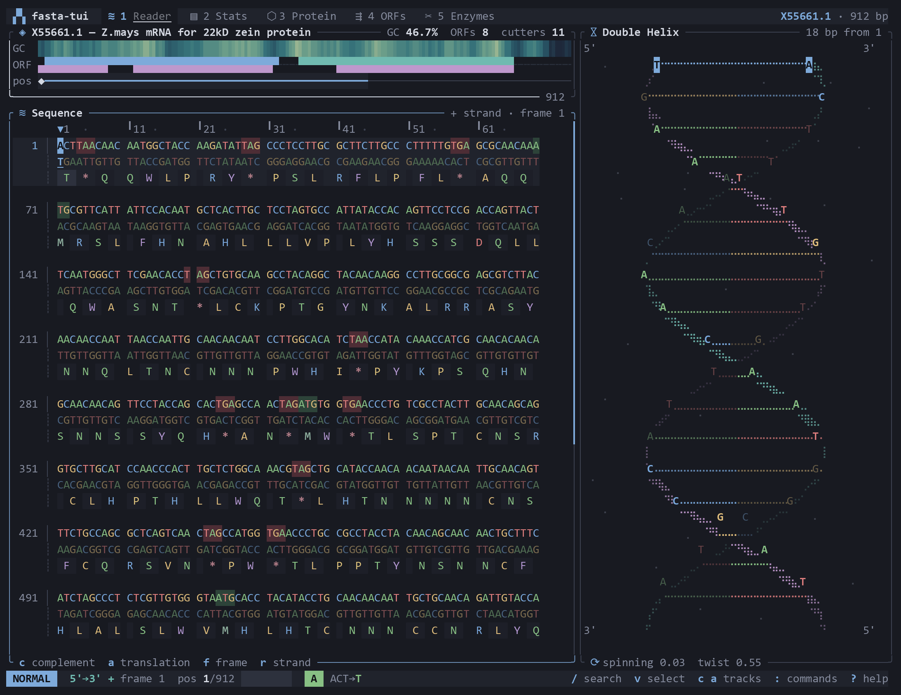
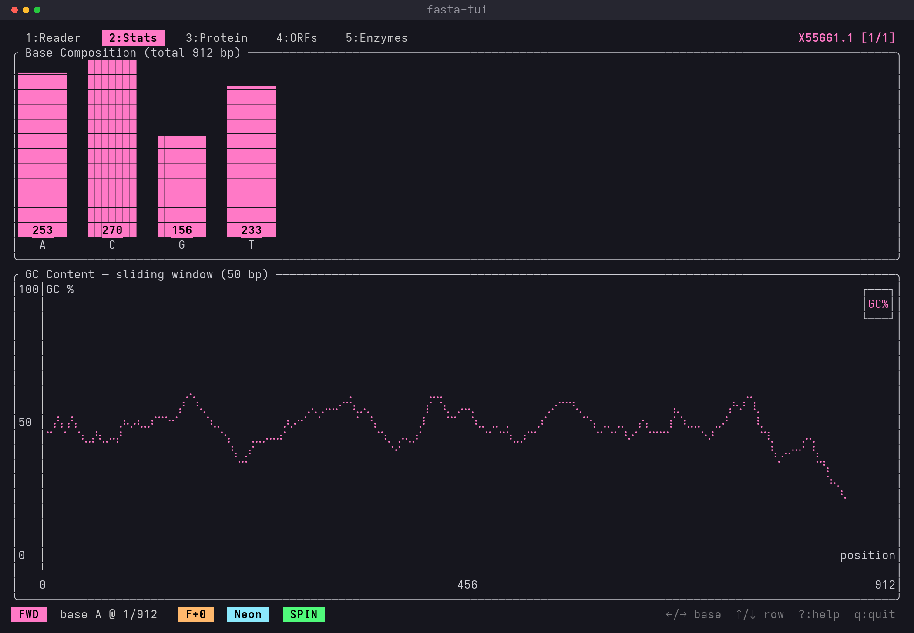
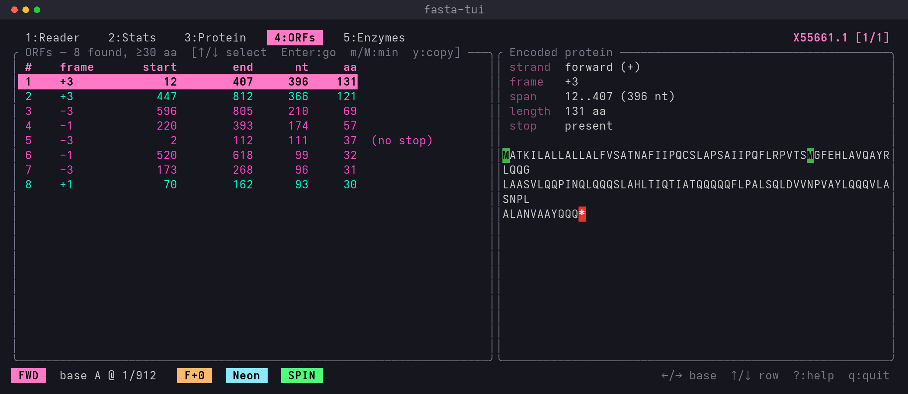
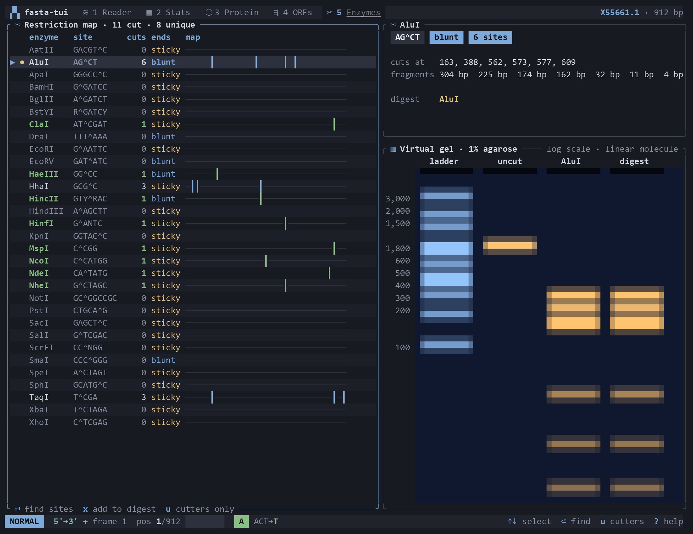

# fasta-tui

[](LICENSE)
[](https://www.rust-lang.org)
[](https://ratatui.rs)

A terminal viewer for FASTA DNA sequences, built with [Ratatui](https://ratatui.rs).
It pairs a color-coded sequence browser with an animated, depth-shaded Braille
double helix, plus composition statistics, live amino-acid translation, a
six-frame ORF finder, a restriction map and primer-grade melting temperatures —
all inside your terminal.

<p align="center">
  
</p>

## Features

- **Sequence reader** — a genome-browser-style, double-stranded view: each row
  shows the forward strand, its complement (`c`) and the amino-acid
  translation of the active frame (`a`), with codon boundaries shaded. Start
  and stop codons are highlighted *in frame*, a column ruler tracks the cursor,
  and the cursor row is banded.
- **Genome overview** — the whole record squeezed into three tracks above the
  reader: a GC heatmap at double horizontal resolution, ORFs on both strands,
  and the viewport, selection and motif hits. Click or drag it to scrub.
- **3D double helix** — a Braille-rendered, rotating double helix with
  continuous depth shading, a thicker front backbone, and rungs split into
  their two bases' colors. It spins on idle and rotates as you scroll; speed
  and twist are adjustable.
- **Stats view** — base composition with smooth sub-cell bars, a dinucleotide
  observed/expected heatmap (CpG depletion jumps out), GC content and GC skew
  along the record with the cursor marked, and a textbook-layout codon usage
  table shaded by frequency for the active strand and frame.
- **Protein view** — live translation colored by physicochemical class, a
  Kyte–Doolittle hydropathy profile above it, and the cursor linked to the
  reader so the arrows walk residue by residue.
- **ORF finder** — a six-frame ORF table with inline length bars, a six-frame
  map of every ORF along the record, and the selected ORF's span, mass, GRAVY
  score, class composition and protein. `Enter` drops you at that ORF in the
  reader with its strand and frame already dialled in.
- **Motif search** — incremental motif search accepting the full IUPAC alphabet
  (`N`, `R`, `Y`, `W`, …), optionally matching the reverse complement too, with
  match highlighting and jump-to-next/previous navigation.
- **Restriction map** — 31 common type-II enzymes digested against the current
  record, each row with an inline cut map: site counts, cut positions, linear
  fragment sizes, blunt/sticky ends, and unique cutters flagged for cloning.
  `Enter` searches a site in the reader.
- **Virtual gel** — the selected digest run on an animated agarose gel beside a
  size ladder, bands placed on a log scale and brightened by mass. Mark enzymes
  with `x` to add a combined multi-enzyme digest lane.
- **Command palette** — `:` or `Ctrl-P` opens a fuzzy-filtered list of every
  action. Type a number (`1,234`, `12.5k`) to jump there, or a DNA motif to
  search it.
- **Mouse support** — click tabs, bases, table rows and ORFs on the six-frame
  map; drag in the reader to select; scroll anywhere.
- **Selection & primer stats** — mark a range with `v`, and the reader reports
  its length, GC content, nearest-neighbour melting temperature (SantaLucia
  1998, salt-corrected) and molecular weight. `y` copies it as FASTA to the
  system clipboard over OSC 52 — no clipboard daemon, works over SSH.
- **Reverse complement & reading frames** — flip to the 3'→5' strand and cycle
  reading frames 0/1/2; the helix, reader, and translation all follow.
- **Multi-record files** — open multi-FASTA files and tab between records.
- **Flexible input** — plain or gzip-compressed FASTA, reading from a file or
  standard input (`-`), with RNA (`U`) and IUPAC ambiguity codes accepted.
- **Protein export** — `--export-protein` translates every record to a protein
  FASTA file (or stdout) headlessly, for use in scripts and pipelines.
- **Themes** — four truecolor palettes (Neon, Aurora, Pale, High-Contrast),
  with animated gradient borders, view fade-ins and slide-in notifications.
  A truecolor terminal is recommended.

## Screenshots

<table>
  <tr>
    <td width="50%" valign="top">
      
      <p align="center"><em>Stats — base composition &amp; GC sliding window</em></p>
    </td>
    <td width="50%" valign="top">
      
      <p align="center"><em>ORF finder — six frames, longest first, with translation</em></p>
    </td>
  </tr>
  <tr>
    <td colspan="2" valign="top">
      
      <p align="center"><em>Restriction map — type-II enzymes, cut sites and end types</em></p>
    </td>
  </tr>
</table>

## Installation

Requires a [Rust toolchain](https://rustup.rs/) (edition 2021).

```bash
git clone https://github.com/Huseynteymurzade28/fasta-tui.git
cd fasta-tui
cargo build --release
# the binary lands at target/release/fasta-tui
```

To install it onto your `PATH`:

```bash
cargo install --path .
```

## Usage

Pass the path to a FASTA file as the only argument:

```bash
cargo run --release -- samples/synthetic.fa
# or, if installed:
fasta-tui samples/synthetic.fa

# gzip files work as-is, and `-` reads from standard input:
fasta-tui sequence.fasta.gz
curl -s https://example.org/genome.fa | fasta-tui -
```

A [`samples/`](samples/) folder with ready-to-use FASTA files — including a real
GenBank record — is included to try it out. See [`samples/README.md`](samples/README.md).

Supported input:

- `.fasta` / `.fa` text files with one or more `>` header records.
- Gzip-compressed input, detected by magic bytes (the `.gz` extension is optional).
- Standard input via `-`, so `fasta-tui` slots into Unix pipelines.
- Header-less raw sequence files (gathered into a single anonymous record).
- Lower-case letters, whitespace, and line wrapping are all fine — the parser
  uppercases input, reads RNA `U` as `T`, keeps IUPAC ambiguity codes
  (`N`, `R`, `Y`, …), and ignores gaps and digits.

### Exporting protein translations

Translate every record to protein and write a FASTA file without opening the
TUI — handy for scripting:

```bash
# forward strand, reading frame 0, to a file
fasta-tui sequence.fasta --export-protein proteins.faa

# reverse strand in frame 1, straight to stdout
fasta-tui sequence.fasta --export-protein - --reverse --frame 1
```

### Finding ORFs headlessly

```bash
# every ORF of 60+ amino acids in all six frames, as protein FASTA
fasta-tui sequence.fasta --export-orfs orfs.faa --min-orf 60

# straight to stdout, so it pipes
fasta-tui sequence.fasta --export-orfs - | grep '^>'
```

Each header records the strand, frame, span and length:

```
>X55661.1_orf1 strand=+ frame=3 start=12 end=407 len=131aa
```

### Restriction mapping headlessly

`--restriction-map` prints one TSV row per enzyme that cuts, ready for `awk`,
`cut` or a spreadsheet:

```bash
fasta-tui sequence.fasta --restriction-map
```

```
record     enzyme  site      sites  positions        fragments
X55661.1   AluI    AG^CT     6      163,388,562,…    162,225,174,11,4,32,304
X55661.1   ClaI    AT^CGAT   1      832              831,81
```

## Key bindings

Press `?` at any time to toggle the in-app key reference.

### Navigation

| Key | Action |
| --- | --- |
| `←` / `h`, `→` / `l` | Move the cursor one base left / right |
| `↑` / `k`, `↓` / `j` | Move the cursor one row up / down |
| `PageUp` / `PageDown` | Move one page |
| `Home` / `g`, `End` / `G` | Jump to the start / end of the record |
| `Tab` / `]` | Next FASTA record |
| `BackTab` / `[` | Previous FASTA record |

### Views

| Key | Action |
| --- | --- |
| `1` … `5` | Switch view: Reader / Stats / Protein / ORFs / Enzymes |
| `r` | Toggle reverse-complement strand |
| `f` | Cycle reading frame 0 / 1 / 2 |
| `c` / `a` | Toggle the complement / translation tracks in the reader |
| `t` | Cycle color theme |

### Search

| Key | Action |
| --- | --- |
| `/` | Start a motif search (any IUPAC code, `Enter` to confirm, `Esc` to cancel) |
| `n` / `N` | Jump to the next / previous match |
| `b` | Toggle reverse-complement matching (minus-strand hits are underlined) |

### Selection

| Key | Action |
| --- | --- |
| `v` | Start a selection at the cursor, or drop the current one |
| `y` | Copy the selection (or, in the ORF view, its protein) to the clipboard |

Dragging with the mouse selects too. The selected range is tinted, and a panel
under the reader shows the length, GC content, melting temperature and
molecular weight of what you picked.

### ORF table (view `4`)

| Key | Action |
| --- | --- |
| `↑` / `↓` | Select an ORF |
| `Enter` | Show it in the reader, selected, on its own strand and frame |
| `m` / `M` | Lower / raise the minimum ORF length by 10 aa |
| `y` | Copy the ORF's protein as FASTA |

### Enzyme table (view `5`)

| Key | Action |
| --- | --- |
| `↑` / `↓` | Select an enzyme |
| `Enter` | Search its recognition site in the reader |
| `x` | Add / remove the enzyme from the combined digest on the gel |
| `u` | Show only the enzymes that actually cut |

### Helix controls

| Key | Action |
| --- | --- |
| `Space` | Pause / resume the idle spin |
| `+` / `-` | Spin faster / slower |
| `>` / `<` | More / less twist |

### General

| Key | Action |
| --- | --- |
| `:` / `Ctrl-P` | Open the command palette |
| `?` | Toggle the help overlay |
| `Esc` | Close the help, else drop the selection, else clear the search, else quit |
| `q` | Quit |

## Status bar

The bottom line shows a mode chip (`NORMAL`, `SELECT`, `COMMAND`, `SEARCH`),
the strand and frame, the cursor position with a progress bar through the
record, the base under the cursor and the codon it belongs to (`ATG→M`), and
chips for the active selection and search. The right side lists the keys that
matter in the current view. Confirmations and errors appear as toasts in the
bottom-right corner.

## Project layout

```
src/
├── main.rs            # entry point + event loop (fixed-rate animation clock, input)
├── cli.rs             # command-line argument parsing (clap)
├── theme.rs           # color palettes shared across widgets
├── fasta/             # domain layer (no UI dependencies)
│   ├── parse.rs       # multi-record FASTA parser
│   ├── record.rs      # Record model, complement / reverse-complement
│   ├── stats.rs       # composition, GC / skew windows, dinucleotides, codon usage
│   ├── aa.rs          # amino-acid classes and Kyte–Doolittle hydropathy
│   ├── translate.rs   # codon → amino-acid translation (standard code)
│   ├── iupac.rs       # ambiguity-code aware pattern matching
│   ├── orf.rs         # six-frame open reading frame detection
│   ├── enzymes.rs     # restriction enzyme table + digestion
│   └── oligo.rs       # Tm (nearest-neighbour / Wallace), MW, composition
├── app/               # application state + input handling
│   ├── mod.rs         # App state, navigation, search, ORFs, selection
│   ├── input.rs       # key-event → state mutation mapping
│   ├── mouse.rs       # clicks, drags and the wheel, via the last frame's hit map
│   ├── commands.rs    # command palette: actions, fuzzy matching
│   └── clipboard.rs   # OSC 52 clipboard copy (no external dependency)
└── ui/                # rendering layer (Ratatui)
    ├── mod.rs         # top-level layout, header, status line, toasts, panels
    ├── fx.rs          # truecolor effects: gradients, fades, sub-cell bars, heat ramps
    ├── reader.rs      # double-stranded reader with translation track
    ├── overview.rs    # whole-record GC / ORF / viewport tracks
    ├── helix.rs       # the 3D Braille double helix
    ├── stats.rs       # composition, dinucleotide heatmap, GC charts, codon table
    ├── protein.rs     # amino-acid translation view
    ├── orf.rs         # ORF table, six-frame map, encoded protein
    ├── enzymes.rs     # restriction map + cut sites
    ├── gel.rs         # animated virtual agarose gel
    ├── command.rs     # command palette popup
    └── help.rs        # key-binding overlay
```

The codebase keeps a clean separation: the `fasta` module is pure domain logic
with unit tests and no terminal dependencies, `app` owns mutable state and input,
and `ui` is a stateless rendering layer that reads `&App` each frame.

## Development

```bash
cargo build      # compile
cargo test       # run the unit tests (parser, stats, translation, ORFs, enzymes, Tm)
cargo clippy     # lint
cargo run -- samples/synthetic.fa
```

The render loop polls for input on an 80 ms timeout and advances the helix
animation each tick, so the visualization keeps spinning even while idle.

## Dependencies

- [`ratatui`](https://crates.io/crates/ratatui) — terminal UI framework
- [`crossterm`](https://crates.io/crates/crossterm) — terminal backend / input
- [`clap`](https://crates.io/crates/clap) — command-line argument parsing

## License

Released under the [MIT License](LICENSE).
